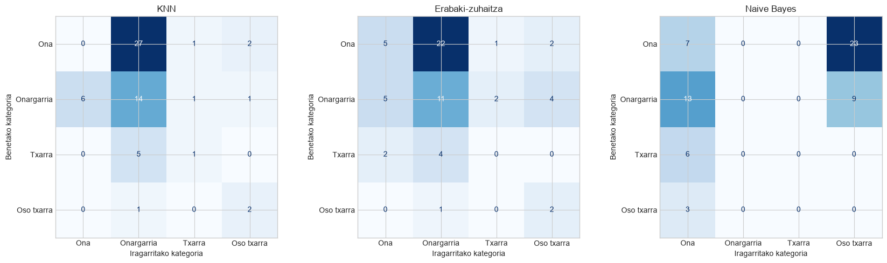
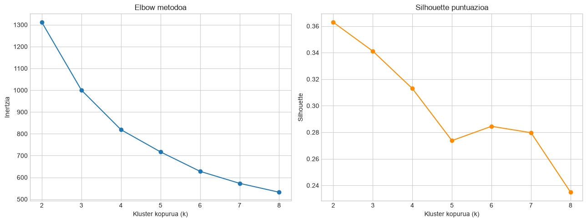

# Ereduen konparazio-txostena

**Erronka:** 2. Erronka – Smart Environment AI · **Modulua:** Ikaskuntza automatikoen sistemak · **Taldea:** 3. taldea

Xehetasun guztiak eta kodea: `erronka_SAA.ipynb`.

## Aurkibidea

1. [Laburpena](#1-laburpena)
2. [Datuak eta ebaluazioa](#2-datuak-eta-ebaluazioa)
3. [Erregresioa](#3-erregresioa)
4. [Sailkapena](#4-sailkapena)
5. [Klusterrak](#5-klusterrak)
6. [Aukeratutako eredua](#6-aukeratutako-eredua)
7. [Mugak](#7-mugak)
8. [Iturriak](#8-iturriak)

## 1. Laburpena

| Arazoa | Eredu onena | Emaitza (*test*) | Balorazioa |
|---|---|---|---|
| Egun bereko PM10-a kalkulatzea | Ridge (`alpha ≈ 31,6`) | MAE 1,82 µg/m³, R² 0,36 | **Aukeratua**, doitasun apalarekin |
| Biharko PM10-a iragartzea | Ridge | R² -0,03 | Ez da erabilgarria |
| O3-ren kategoria sailkatzea | KNN (`k = 9`) | Accuracy 0,28, F1 0,28 | Ez da nahikoa |
| Egun-motak aurkitzea | K-means (`k = 3`) | Silhouette 0,34 | Interpretagarria, baina taldeak ez daude oso bereizita |

## 2. Datuak eta ebaluazioa

Mundakako estazioko eguneko datuak erabili ditugu: 306 egun, 2026-01-01etik 2026-11-02ra. PM10-a erregresioaren helburua denez, hutsik duten 49 egunak kendu ditugu, eta 257 egun geratu dira.

Datuak denbora-serie bat dira, eta horregatik:

- **Banaketa kronologikoa:** lehen %80 entrenatzeko eta azken %20 probatzeko (erregresioan, 205 eta 52 egun).
- **Balidazioa:** `TimeSeriesSplit` (5 zati). Hiperparametroak eta eredua balidazioarekin aukeratu ditugu, ez *test* multzoarekin.
- **Aurreprozesamendua *pipeline*-aren barruan:** mediana, estandarizazioa eta *one-hot*, *train* multzoarekin bakarrik doituta.

Ausazko banaketak emaitzak puztu egiten ditu, egun jarraituak oso antzekoak direlako. Ridge-k, adibidez, R² ≈ 0,75 lortuko luke ausazko banaketarekin, eta kronologikoarekin R² ≈ 0,36 lortzen du. Txosten honetako emaitzak kronologikoak dira, ausazkoa dela esaten ez bada.

## 3. Erregresioa

| Eredua | Balidazio RMSE | MAE | RMSE | R² | R² (ausazkoa) |
|---|---|---|---|---|---|
| Lineal sinplea (`PM2,5`) | 2,90 | 1,93 | 2,60 | 0,26 | 0,71 |
| Lineal anizkoitza | 3,22 | 1,89 | 2,60 | 0,26 | 0,67 |
| **Ridge** (`alpha ≈ 31,6`) | **2,73** | **1,82** | **2,42** | **0,36** | 0,75 |
| Lasso (`alpha = 1`) | 2,80 | 1,85 | 2,40 | 0,37 | 0,69 |

MAE eta RMSE µg/m³-tan daude.

- **Ridge da onena balidazioan.** Lasso-k *test*-ean apur bat hobeto egiten du, baina aldea oso txikia da eta *test* multzoa ez dugu aukeratzeko erabiltzen.
- **Erregularizazioak laguntzen du:** 205 errenkadarentzat 21 ezaugarri ditugu, eta batzuk oso lotuta daude (NO, NOX, NO2).
- **`PM2,5` da aldagai nagusia:** bakarrik erabilita ere, ezaugarri guztiekin egindako erregresio lineal anizkoitzaren parean dago.

**Biharko PM10-a.** Benetako aurreikuspena ere probatu dugu, gaurko eta atzoko datuekin. Ridge-k R² ≈ -0,03 lortzen du, eta gaurko balioa errepikatzen duen eredu naifak R² ≈ -0,12. Bat ere ez da beti batezbestekoa iragartzea baino hobea, beraz datu hauekin ezin da biharko PM10-a modu erabilgarrian iragarri.

## 4. Sailkapena

Lau kategoria sortu ditugu O3-ren arabera: Ona (< 60), Onargarria (60-75), Txarra (75-90) eta Oso txarra (≥ 90). **Kategoria hauek erlatiboak dira** eta Mundakako egunak beren artean konparatzen dituzte, ez dute osasun-arriskurik adierazten. ICA ofizialaren atalaseekin, 304 egunetatik 275 kategoria berean leudeke (Nahiko ona), eta ezingo litzateke sailkatzailerik entrenatu. O3 ez dugu ezaugarrien artean sartu, kategoria horrekin sortu baitugu.

| Eredua | Balidazio F1 | Accuracy | Precision | Recall | F1 | Accuracy (ausazkoa) |
|---|---|---|---|---|---|---|
| **KNN** (`k = 9`) | **0,33** | 0,28 | 0,26 | 0,37 | 0,28 | 0,61 |
| Erabaki-zuhaitza (sakonera 8) | 0,29 | 0,30 | 0,24 | 0,33 | 0,24 | 0,53 |
| Naive Bayes | 0,19 | 0,12 | 0,06 | 0,06 | 0,06 | 0,30 |
| Erreferentzia (klase nagusia) | – | 0,10 | – | – | 0,05 | – |

Precision, recall eta F1 `macro` batezbestekoak dira.

- **Hiru ereduak txarrak dira.** KNN da onena balidazioan, baina *test*-eko 30 "Ona" egunetatik bat ere ez du asmatzen, eta gehienak "Onargarria" gisa sailkatzen ditu.
- **Naive Bayes-ek** bi kategoria bakarrik iragartzen ditu: "Ona" eta "Oso txarra".
- **Arrazoia urtaroa da.** O3 gainerako kutsatzaileekin ia ez dago lotuta eta urtaroaren araberakoa da. Entrenamenduan "Txarra" da ohikoena (243tik 95), eta *test*-ean, udazkenean, "Ona" (61etik 30). Urriko eta azaroko daturik ez dago entrenamenduan.
- **"Oso txarra" kategoriak 3 adibide baino ez ditu *test*-ean**, beraz kategoria horren emaitzak ez dira fidagarriak.

## 5. Klusterrak

K-means kutsatzaile guztiekin aplikatu dugu, mediana eta estandarizazioarekin.

Silhouette handiena `k = 2`-k du (0,36), baina `k = 3` oso gertu dago (0,34), eta elbow grafikoan ez dago ukondo argirik. **`k = 3` aukeratu dugu**, interpretazio hobea ematen duelako: `k = 2`-rekin NOx altuko egunak eta O3 eta partikula altuko egunak talde berean nahasten dira. Silhouette-a ez da handia, beraz taldeen arteko mugak ez dira oso garbiak.

| Klusterra | Egunak | NOX | O3 | PM10 | PM2,5 | Noiz |
|---|---|---|---|---|---|---|
| 0 – NOx altuko egunak | 60 | 6,3 | 67,5 | 10,9 | 4,8 | Batez ere urtarriletik martxora eta irailetik azarora |
| 1 – Aire garbiko egunak | 200 | 2,8 | 68,8 | 10,1 | 4,7 | Urte osoan |
| 2 – O3 eta partikula altuko egunak | 44 | 4,3 | 88,8 | 19,8 | 11,4 | Batez ere martxotik irailera |

Balioak batezbestekoak dira, µg/m³-tan. Enuntziatuak aipatzen dituen «trafiko-ordu puntak» edo «inbertsio termikoko egunak» ezin ditugu baieztatu, eguneko datuak bakarrik ditugulako eta meteorologia-daturik ez dugulako. 0. eta 2. klusterren kausak hipotesiak dira.

## 6. Aukeratutako eredua

**Ridge erregresioa (`alpha ≈ 31,6`), egun bereko PM10-a kalkulatzeko.** Fitxategia: `pm10_eredua.pkl`.

1. **Balidazioan onena da** erregresio-ereduen artean (RMSE ≈ 2,73).
2. **Sailkapena baino erabilgarriagoa da:** batezbestekoa iragartzea baino hobea da (R² ≈ -0,14 → 0,36), eta sailkatzaileek ez dute emaitza fidagarririk ematen.
3. **Benetako erabilera bat du:** PM10 neurgailuak 49 egunetan ez du daturik eman, eta ereduak balio horiek gainerako neurketekin kalkula ditzake.
4. **Arina da** Jetson Nano-n exekutatzeko.

K-means-a (`kmeans_eredua.pkl`) osagarri gisa gorde dugu, dashboard-ean egun berri bakoitzaren mota erakusteko. MLP sare neuronalarekin egindako konparazioa MIA zatian dago (`eredu_aukeraketa.md`).

## 7. Mugak

- **Doitasun apala:** R² ≈ 0,36 da, eta ereduak PM10-aren aldakortasunaren zati bat bakarrik azaltzen du.
- **Ez da aurreikuspena:** egun bereko neurketak behar ditu.
- **Datu gutxi:** estazio bakarra, eguneko datuak eta urte bateko 306 egun. Ezin da urtaroen eragina ondo ikasi.
- **Test multzo txikia:** erregresioan 52 egun, udazkenekoak bakarrik.
- **Hobetzeko:** urte gehiagoko datuak, estazio gehiago eta meteorologia-aldagaiak (haizea, euria, presioa).

## 8. Iturriak

- Datuak: [Open Data Euskadi](https://opendata.euskadi.eus), Euskadiko airearen kalitatearen sarea (Mundaka estazioa).
- Airearen kalitatearen indizea (ICA): [MITECO](https://www.miteco.gob.es/es/calidad-y-evaluacion-ambiental/temas/atmosfera-y-calidad-del-aire/visualizacion-datos-calidad-del-aire/ica.html).
- [scikit-learn dokumentazioa](https://scikit-learn.org/stable/): `Pipeline`, `TimeSeriesSplit`, `GridSearchCV`, `KMeans`.
